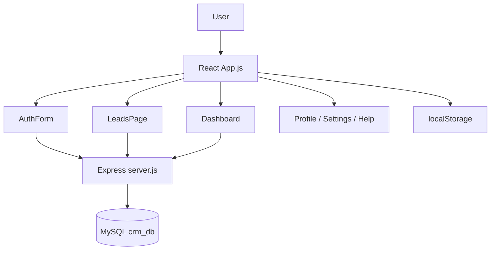
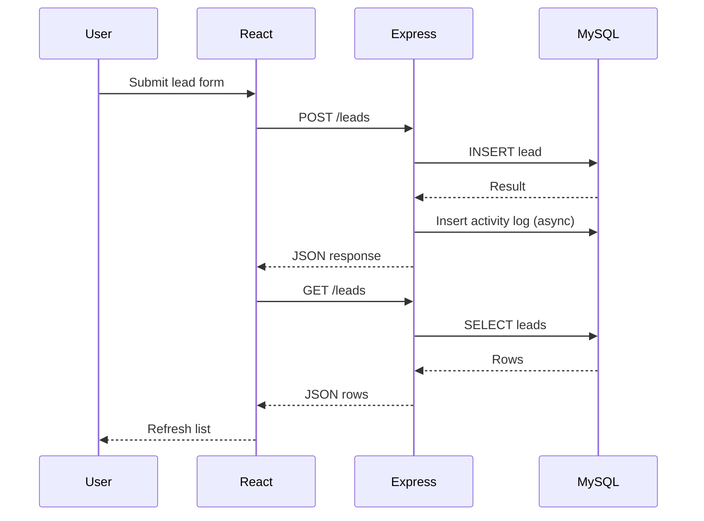

# Architecture

## Overview

The application follows a three-layer client/server/database architecture. React manages screens and browser state; Express handles HTTP requests and SQL operations; MySQL persists users, leads and activity logs.

## Components and responsibilities

- App.js controls view navigation, login state, search and notifications. The reviewed snapshot restores saved user data but selects the landing view on startup; login selects the dashboard.
- AuthForm sends signup/login requests. The backend hashes passwords with bcrypt (10 rounds) and compares hashes on login.
- LeadsPage fetches all leads and performs filtering, sorting and pagination in the browser. Create/update/delete operations call the API; bulk deletion sends multiple DELETE requests.
- Dashboard requests aggregate counts and the five latest activity logs.
- ProfilePage and SettingsPage mainly manage local React state and simulated actions. HelpPage provides help content.
- server.js contains connection setup, routes and activity logging in one CommonJS module. Express parses JSON and enables CORS.

## Data flow

## Database entities

| Entity | Fields referenced by source |
|---|---|
| users | name, email, password, phone, role |
| leads | id, name, email, phone, company, status, created_at (frontend sorting) |
| activity_logs | user_name, action, details, created_at |

No database export or foreign-key definitions were supplied. The code does not establish a relational link between a lead and a user. See README for a proposed minimal schema.

## Security boundary and limitations

The UI role checks are not a server security boundary. Login returns the full selected user row, including the password hash, and the frontend saves user data in localStorage. The API has no session/token validation or role middleware. CORS is unrestricted and database credentials are hardcoded. Parameterized SQL and bcrypt are present but do not make the application production-ready. Password change is implemented in the API but not connected to the settings UI. Activity writes are asynchronous and not transactional with lead writes.

Future design: environment-based configuration, restricted CORS, server-side authorization, sanitized responses, validated inputs, persistent profile/settings, real audit identity, and automated integration tests.
