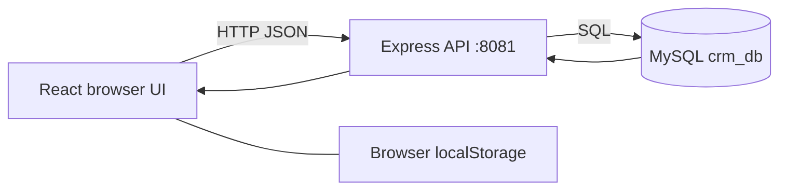

# Mini CRM — Customer Relationship Management System

A full-stack web application for managing sales leads and monitoring customer acquisition activity. The React interface communicates with an Express API backed by MySQL. Originally developed as FUTURE_FS_01.

## Features

- Registration and login with bcrypt password hashing.
- Lead creation, viewing, editing and deletion, including bulk deletion through individual API calls.
- Search by name, email or company; status filtering, date sorting and pagination (five leads per page).
- Dashboard showing total, new and converted leads and the five most recent activity logs.
- Admin, Sales and Staff interface roles. Admin can edit and delete; Sales can edit; Staff is read-only in the UI. These restrictions are not enforced by the API.
- Profile, settings and help screens; animated landing page.
- Backend password-change endpoint; the settings screen does not connect to it.

## Technology stack

| Layer | Technology |
|---|---|
| Frontend | React 19, Create React App (react-scripts 5), Bootstrap 5, Lucide React, Framer Motion |
| Backend | Node.js, Express 5, CommonJS, cors, bcrypt |
| Database | MySQL via mysql 2.x driver |
| Visual effects | Three.js, postprocessing |

## Architecture



## Local installation

Prerequisites: Node.js and npm, a running MySQL server (for example XAMPP MySQL), and a terminal. Use a Node version compatible with the supplied dependencies.

1. Clone the repository or open the existing CRM folder.
2. Create the database and tables using the example below if you do not already have a database. Do not overwrite an existing database.
3. Configure the connection in `backend/server.js` for your local MySQL instance. The existing code uses literal connection settings; `.env.example` is a proposed configuration template and is not loaded automatically. Never commit real credentials. Prefer migrating the connection to environment variables before sharing changes.
4. In one terminal, run:

```sh
cd backend
npm ci
npm start
```

5. In a second terminal from the project root, run:

```sh
cd frontend
npm ci
npm start
```

6. Open the frontend at `http://localhost:3000` (default CRA port). The backend listens on port 8081. The frontend uses hardcoded localhost/127.0.0.1 API URLs.

## Database setup

No SQL export is included in the reviewed archive. The following is a suggested minimal schema inferred from SQL queries and frontend fields, not a recovered original schema. Review it against your existing database first.

```sql
CREATE DATABASE IF NOT EXISTS crm_db;
USE crm_db;
CREATE TABLE IF NOT EXISTS users (
  id INT AUTO_INCREMENT PRIMARY KEY,
  name VARCHAR(150) NOT NULL,
  email VARCHAR(255) NOT NULL UNIQUE,
  password VARCHAR(255) NOT NULL,
  phone VARCHAR(40),
  role VARCHAR(30) DEFAULT 'Staff'
);
CREATE TABLE IF NOT EXISTS leads (
  id INT AUTO_INCREMENT PRIMARY KEY,
  name VARCHAR(150) NOT NULL,
  email VARCHAR(255) NOT NULL,
  phone VARCHAR(40),
  company VARCHAR(200),
  status VARCHAR(30) DEFAULT 'New',
  created_at TIMESTAMP DEFAULT CURRENT_TIMESTAMP
);
CREATE TABLE IF NOT EXISTS activity_logs (
  id INT AUTO_INCREMENT PRIMARY KEY,
  user_name VARCHAR(255),
  action VARCHAR(100),
  details TEXT,
  created_at TIMESTAMP DEFAULT CURRENT_TIMESTAMP
);
```

## API reference

Base URL: `http://localhost:8081`.

| Method | Endpoint | Purpose |
|---|---|---|
| POST | `/signup` | Register user; name, email, password, phone, role |
| POST | `/login` | Verify email and password |
| PUT | `/change-password` | Verify oldPassword and update newPassword for email |
| GET | `/leads` | Retrieve leads |
| POST | `/leads` | Create lead |
| PUT | `/leads/:id` | Update lead |
| DELETE | `/leads/:id` | Delete lead |
| GET | `/dashboard-stats` | Total, new and converted counts |
| GET | `/activity-logs` | Latest five logs |

Lead writes persist name, email, phone, company and status. The UI also exposes source, priority and assignedTo, but the backend does not save them. Activity logging accepts optional user_name for create/update; delete uses a fixed Admin label.

## Usage

Register a test account, sign in, open the dashboard and navigate to Leads. Add a test lead, search or filter it, update its status and check the dashboard counts. Use an Admin test account to verify deletion. Sign out when finished.

## Testing

Run `npm test` in frontend to launch the CRA test runner and `npm run build` to create a production build. The existing App.test.js is a starter test and may not match the current UI. Backend `npm test` is a placeholder. Manually verify signup, login, lead CRUD, statistics, activity logs and error handling against a disposable database.

## Limitations and future improvements

- Profile edits, team invitations, preferences and account deletion are simulated or local-only. CSV export uses demo data. Two-factor authentication is not implemented.
- Add server-side authentication and authorization; signup currently accepts a client-supplied role and API routes lack access-control middleware.
- Remove password hashes from login responses and browser storage; use secure session handling.
- Rotate any exposed database credentials, move secrets to environment variables, restrict CORS and validate requests.
- Check HTTP response status before showing lead-write success; improve audit attribution and error handling.
- Connect settings and profile actions to real APIs and add automated tests.

This is a development project, not a production-ready secure CRM. Documentation is based on static source inspection; runtime behavior has not been tested.

## Additional documentation

- [Architecture](ARCHITECTURE.md)
- [Project structure](PROJECT_STRUCTURE.md)
- [Contributing](CONTRIBUTING.md)
- [Changelog](CHANGELOG.md)
